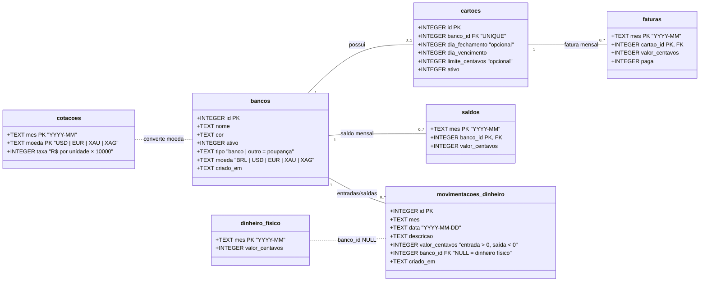

# 💰 Finanças

> Dashboard de finanças pessoais **mensal**, para rodar localmente: quanto dinheiro você tem, quanto deve nos cartões e quanto tem guardado.


Não é um controle de gastos: você **não lança cada compra**. Você registra, mês a mês, os saldos das suas contas e as faturas dos cartões, e lança só o que entrou ou saiu. O sistema calcula o resto.

---

## Sumário

- [Funcionalidades](#-funcionalidades)
- [Como funciona](#-como-funciona)
- [Tecnologias](#-tecnologias)
- [Instalação](#-instalação)
- [Scripts](#-scripts)
- [Backup e restauração](#-backup-e-restauração)
- [Banco de dados](#-banco-de-dados)
- [API](#-api)
- [Estrutura do projeto](#-estrutura-do-projeto)

---

## ✨ Funcionalidades

### 📊 Dashboard

O Dashboard tem duas áreas e um seletor de mês (← dropdown →).

**Conta corrente**
- Cards de **Total disponível** (dinheiro físico + bancos), **Total devido** (faturas não pagas), **Patrimônio líquido** e **Variação vs mês anterior** (em valor e %).
- Gráfico de rosca com a **distribuição do dinheiro**, nas cores de cada banco.
- Gráfico de linha com a **evolução** de disponível, devido, patrimônio e gastos no cartão.
- **Próximos vencimentos** do mês selecionado e do seguinte. Faturas vencidas ficam em vermelho, as que vencem em até 7 dias em amarelo, e há um aviso de faturas em aberto de meses anteriores.
- **Gastos do cartão** no mês: total gasto (faturas pagas + a pagar), quanto já foi pago, quanto falta pagar e a variação em relação ao mês anterior.
- Gráfico de **fatura por cartão** e **uso do limite**: soma das faturas não pagas do mês em diante, incluindo parcelas futuras já lançadas, por cartão e no total.

**Poupança**
- Cards de **Total na poupança**, **Variação vs mês anterior** e **Patrimônio total** (conta corrente + poupança).
- **Distribuição da poupança**, com o valor na moeda original (ex.: `US$ 1.000,00`, `10,50 g`) e o equivalente em reais.
- **Evolução da poupança** mês a mês.

### ✍️ Lançamento do mês
- **Dinheiro físico**, **saldos bancários** e **poupança**, com **± Entradas/saídas** em cada conta. Você informa data, descrição e valor, e o saldo é atualizado na hora.
- **Virada de mês automática:** dinheiro e saldos passam sozinhos para o mês seguinte (↳ *Trazido de out/26*).
- **Faturas dos cartões** com checkbox **Paga**. Ao salvar uma fatura como paga, o valor é **descontado do saldo do banco** do cartão. Ao desmarcar, o valor volta.
- Barra de uso do limite em cada fatura.
- **Cotação do mês** para poupança em moeda estrangeira ou metal, com o botão **⟳ Buscar cotação atual**.
- Barra de totais fixa com prévia antes de salvar.

### 🏦 Bancos, cartões e poupança
- Cadastro de **bancos** com cor de identificação e **cartão de crédito** opcional (dia de fechamento, dia de vencimento e limite).
- Cadastro de **poupanças** (Tesouro, CDB, reservas...) em **Real, Dólar, Euro, Ouro ou Prata**. Ouro e prata são medidos em gramas.
- **Desativar** esconde a conta dos lançamentos novos e mantém o histórico. **Excluir** apaga tudo e pede confirmação digitando o nome.

### 🎨 Interface
- Tema **escuro** por padrão, com opção de claro.
- Responsiva: no celular há uma barra de navegação inferior.
- Interface em português, valores em `R$ 1.234,56` e datas em `dd/mm/aaaa`.

---

## 🧠 Como funciona

| Conceito | Regra |
|---|---|
| **Valores** | Sempre **inteiros em centavos** (nunca float). Gramas usam 2 casas; cotações usam 4 casas (× 10 000). |
| **Herança mês a mês** | Um mês sem valor gravado herda o último valor gravado antes dele. Bancos inativos não herdam. |
| **Propagação** | Mudar o valor de um mês (edição, movimentação ou pagamento de fatura) repassa a diferença aos meses seguintes que têm valor próprio. |
| **Pagamento de fatura** | Desconto = valor da fatura se estiver paga. O saldo do banco recebe *desconto antigo − desconto novo*. |
| **Vencimento** | `mês + dia de vencimento`. O dia 31 vira o último dia em meses curtos. |
| **Conversão** | `valor em reais = quantidade × cotação do mês`. Um mês sem cotação usa a anterior. Ouro e prata vêm por onça troy e são convertidos para grama (÷ 31,1034768). |

**Fórmulas**

```text
Total disponível   = dinheiro físico + saldos bancários
Total devido       = faturas não pagas do mês
Patrimônio líquido = total disponível − total devido
Poupança           = soma das poupanças convertidas para reais
Patrimônio total   = patrimônio líquido + poupança
Uso do limite      = faturas não pagas do mês selecionado em diante ÷ limite
```

---

## 🛠 Tecnologias

| Camada | Stack |
|---|---|
| Frontend (`/web`) | React 19 · Vite 7 · TypeScript · Tailwind CSS 4 · Recharts 3 · React Router 7 |
| Backend (`/server`) | Node.js · Express 5 · TypeScript (tsx) |
| Banco de dados | SQLite via better-sqlite3, num único arquivo local |
| Cotações | [AwesomeAPI](https://docs.awesomeapi.com.br/) (opcional, só quando você clica em *Buscar cotação atual*) |

---

## 🚀 Instalação

**Requisitos**
- Node.js 20 ou mais recente (testado com 22)
- Ferramentas de compilação para o `better-sqlite3`
  - Arch / CachyOS: `sudo pacman -S base-devel python`
  - Debian / Ubuntu: `sudo apt install build-essential python3`

**Modo desenvolvimento**

```bash
git clone https://github.com/keandro/financas.git
cd financas
npm install        # instala server e web (npm workspaces)
npm run seed       # opcional: dados de exemplo dos últimos 6 meses
npm run dev        # API em :3001 + site em :5173
```

Abra **http://localhost:5173**.

**Uso no dia a dia (produção local)**

```bash
npm start          # compila server e web e sobe um único servidor em http://localhost:3001 (API + site)
```

---

## 📜 Scripts

| Comando | Descrição |
|---|---|
| `npm run dev` | Sobe API e frontend com recarga automática |
| `npm run build` | Compila `server` e `web` |
| `npm start` | Compila e sobe o servidor de produção (API + site) |
| `npm run seed` | Cria dados de exemplo, apenas se o banco estiver vazio |
| `npm run seed -- --reset` | ⚠️ **Apaga todos os dados** e recria o exemplo |
| `npm run backup` | Cria uma cópia do banco em `backups/` |

---

## 💾 Backup e restauração

Todos os dados ficam em um único arquivo: **`server/data/financas.db`**.

**Backup** (funciona com o servidor rodando):

```bash
npm run backup
# → backups/financas-2026-10-09-16-30-00.db
```

O script usa a API de backup do SQLite, então a cópia é sempre consistente. Para copiar o arquivo à mão, pare o servidor antes e copie também `financas.db-wal` e `financas.db-shm`, se existirem.

**Restauração**
1. Pare o servidor.
2. Substitua `server/data/financas.db` pelo arquivo de backup.
3. Apague `financas.db-wal` e `financas.db-shm`, se existirem.
4. Inicie o servidor de novo.

> 💡 Guarde a pasta `backups/` num lugar sincronizado (Google Drive, Syncthing etc.).

---

## 🗄 Banco de dados

O esquema é criado e atualizado automaticamente ao iniciar o servidor. As migrations ficam em [`server/src/db/migrations.ts`](server/src/db/migrations.ts) e são numeradas: a versão aplicada fica em `PRAGMA user_version`.

### Diagrama de classes



| Tabela | Finalidade |
|---|---|
| `bancos` | Contas: bancos (`tipo = banco`) e poupanças (`tipo = outro`), cada uma com sua moeda |
| `cartoes` | Cartão de crédito de um banco (no máximo um por banco) |
| `saldos` | Saldo de cada conta num mês. Meses sem linha herdam o anterior |
| `faturas` | Valor e status (paga ou não) da fatura de cada cartão no mês |
| `dinheiro_fisico` | Dinheiro em espécie do mês |
| `movimentacoes_dinheiro` | Entradas e saídas manuais (dinheiro físico ou uma conta) |
| `cotacoes` | Cotação mensal de USD, EUR, ouro e prata em reais |

---

## 🔌 API

Base: `http://localhost:3001/api`

| Método | Rota | Descrição |
|---|---|---|
| `GET` | `/bancos` | Lista bancos e poupanças (com cartão) |
| `POST` | `/bancos` | Cria um banco ou uma poupança (`tipo`, `moeda`, `cartao` opcional) |
| `PUT` | `/bancos/:id` | Edita nome, cor, ativo, moeda e cartão (`cartao: null` desativa o cartão) |
| `DELETE` | `/bancos/:id` | ⚠️ Exclui a conta com cartão, saldos, faturas e movimentações |
| `GET` | `/lancamentos/:mes` | Formulário do mês (valores gravados ou herdados, faturas, movimentações e cotações) |
| `PUT` | `/lancamentos/:mes` | Salva o mês (ajusta saldos ao pagar ou desmarcar faturas) |
| `POST` | `/lancamentos/:mes/movimentacoes` | Adiciona entrada/saída (`banco_id: null` = dinheiro físico) |
| `DELETE` | `/lancamentos/:mes/movimentacoes/:id` | Remove a movimentação e desfaz o valor |
| `GET` | `/resumo/:mes` | Totais, variações, distribuições, faturas e uso do limite |
| `GET` | `/historico/:mes?n=12` | Evolução dos últimos *n* meses |
| `GET` | `/vencimentos` | Faturas não pagas, por data de vencimento |
| `GET` | `/meses` | Meses com algum lançamento |
| `GET` | `/cotacoes/atual` | Cotação atual de USD, EUR, ouro e prata (R$/g), consulta externa |

---

## 📁 Estrutura do projeto

```text
financas/
├── package.json              # npm workspaces + scripts
├── server/
│   ├── data/financas.db      # banco SQLite (fora do git)
│   └── src/
│       ├── index.ts          # servidor Express
│       ├── db/               # conexão e migrations
│       ├── lib/              # contas (herança), cotações, cálculos, datas, validação
│       ├── routes/           # bancos, lançamentos, resumo
│       └── scripts/          # seed e backup
└── web/
    └── src/
        ├── pages/            # Dashboard, Lançamento, Bancos e cartões
        ├── components/       # gráficos, campo de moeda, seletor de mês, movimentações
        ├── contexts/         # tema e mês selecionado
        └── lib/              # cliente da API e formatação
```
